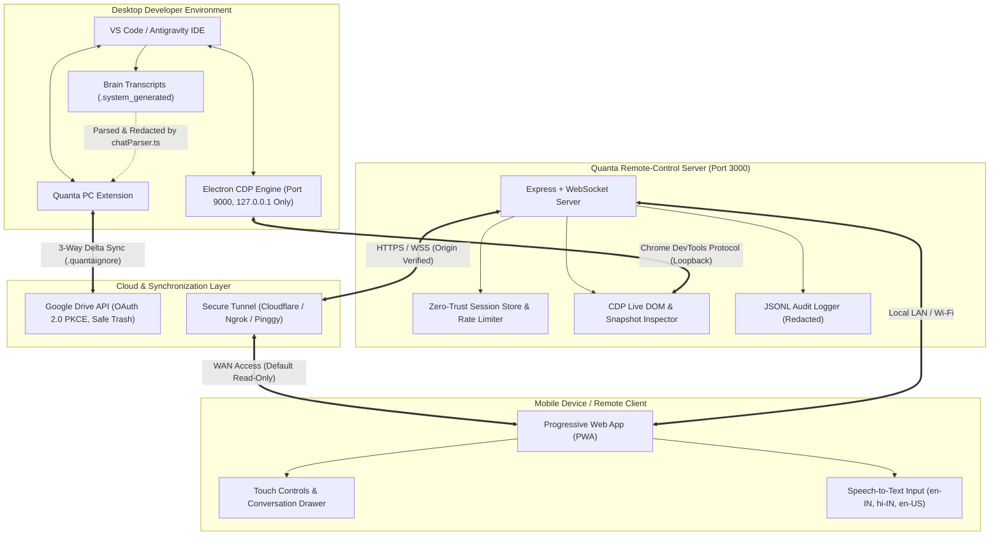

<div align="center">

# 🌌 Quanta IDE

### **Next-Generation Cloud Workspace Synchronization & Real-Time Mobile Remote Control**

[](https://github.com/dark-yoddha/Quanta-IDE)
[](https://nodejs.org/)
[](https://www.typescriptlang.org/)
[](https://code.visualstudio.com/)
[](LICENSE)

<br/>

<!-- Hero Demo GIF placeholder (See docs/media/RECORDING.md for recording instructions) -->
<!--  -->

**Built with passion by:**
<br/>
[**Akira-official**](https://github.com/Akira-official) &bull; [**dark-yoddha**](https://github.com/dark-yoddha)

---

</div>

## 📌 Executive Summary

**Quanta IDE** is a modern developer ecosystem designed to bridge desktop IDE power with untethered mobility and cloud synchronization. Built specifically for developers using **VS Code** and **Google Antigravity IDE**, Quanta provides two tightly integrated core systems:

1. **`Quanta-PC-Extension`**: A native VS Code extension that enables intelligent, three-way delta-hashed bidirectional workspace synchronization with **Google Drive**, alongside automated chat transcript ingestion, redaction, and client-side encryption from Antigravity AI sessions.
2. **`Remote-Control`**: A high-performance, real-time Node.js + WebSocket server that hooks directly into Antigravity's Chromium/Electron process via the Chrome DevTools Protocol (CDP), streaming live visual snapshots and AI thinking states to any mobile PWA across LAN or encrypted global tunnels with server-enforced read-only security.

---

## 🏛️ System Architecture



---

## 🔒 Security Model & Hardening

Quanta IDE enforces an enterprise-grade defense-in-depth security model:

- **Server-Enforced Read-Only Mode:** All external and tunnel connections connect in `read-only` mode by default. Action routes (`/send`, `/stop`, `/set-mode`, `/new-chat`, `/upload-file`) reject unauthorized commands with `403 Forbidden` on the server.
- **Timing-Safe Authentication:** Passwords are verified in constant time (`crypto.timingSafeEqual`) with SHA-256 pre-hashing to eliminate timing side-channel attacks.
- **Brute-Force Lockout:** In-memory token-bucket rate limiting enforces temporary lockouts after 5 consecutive failures with exponential backoff.
- **Ephemeral Pairing Tickets:** QR codes utilize 120-second single-use tickets (`/pair?ticket=...`) eliminating exposed passwords in URLs or proxy logs.
- **CDP Loopback Guard:** Startup self-check probes all LAN interfaces to verify port 9000 is not exposed to the local network or internet.
- **Structured JSONL Audit Log:** All authentication, commands, and mode changes are logged to `Remote-Control/logs/audit.jsonl` with automatic credential redaction and file rotation.
- **PKCE OAuth & Ephemeral Ports:** Google Drive authentication uses ephemeral OS-allocated ports (`127.0.0.1:0`) and RFC 7636 PKCE (`S256`), eliminating port 3000 collisions.
- **Token Vaulting:** OAuth tokens are vaulted in `vscode.SecretStorage` with silent refresh handling.

*For complete details, see [docs/SECURITY.md](docs/SECURITY.md).*

---

## ✨ Core Pillars & Features

### 1. 🔌 Quanta PC Extension (`Quanta-PC-Extension`)

- **🛡️ `.quantaignore` Engine**:
  - Automatically excludes `.env*`, `client_secret*.json`, certificates (`*.pem`, `*.key`), `node_modules/`, `.git/`, and build artifacts from cloud synchronization.
- **⚡ Three-Way Conflict Detection (`quanta.push` & `quanta.pull`)**:
  - Tracks base states via `.quanta/sync-manifest.json`.
  - Accurately detects concurrent local and remote edits, offering `Keep local`, `Keep remote`, `Keep both`, or interactive diffing.
- **👁️ Dry-Run Preview (`quanta.preview`)**:
  - Interactive preview dialog displaying pending additions, modifications, deletions, and conflicts before changes take place.
- **🗑️ Safe Trashing & Mass-Delete Guard**:
  - Removed files are sent to **Google Drive Trash** (`PATCH` with `trashed: true`) rather than permanently destroyed.
  - Deletions exceeding 20 files or 30% of the workspace trigger an extra modal confirmation guard.
- **🧠 Transcript Redaction & Client-Side Encryption (`quanta.syncChats`)**:
  - Automatically strips API keys, JWTs, Bearer headers, private keys, and `.env` assignments.
  - Optional client-side AES-256-GCM encryption with `scrypt` key derivation.
- **📊 VS Code Status Bar Integration**:
  - Real-time indicator displaying `$(cloud) Quanta: In Sync`, `$(sync~spin) Quanta: Pushing...`, or `$(alert) Quanta: Conflict`.

---

### 2. 📱 Quanta Remote-Control (`Remote-Control`)

- **⚡ Sub-100ms Real-Time Mirroring**:
  - Low-latency visual snapshots and DOM streaming directly from Antigravity's Chromium process.
- **📲 Progressive Web App (PWA)**:
  - Installable standalone app on iOS and Android with custom splash screen and offline service worker caching (`sw.js`).
- **🎙️ Voice-to-Text Input**:
  - Dictate prompts hands-free with Web Speech API integration supporting `en-IN`, `hi-IN`, and `en-US`.
- **🔔 Push & Sound Alerts**:
  - Web Push notifications alerted when an agent completes execution or pauses for input.
- **🩺 Quanta Doctor CLI (`npm run doctor`)**:
  - Automated diagnostic tool verifying Node version, environment variables, CDP loopback binding, brain folder detection, and port allocations.

---

## ⌨️ Extension Commands Reference

| Command ID | Title | Description |
| :--- | :--- | :--- |
| `quanta.login` | **Quanta: Connect Google Drive** | Initiates loopback OAuth 2.0 PKCE browser authorization. |
| `quanta.logout` | **Quanta: Disconnect Google Drive** | Revokes active Google Drive tokens and wipes local secret vault. |
| `quanta.preview` | **Quanta: Preview Sync Changes** | Analyzes local vs remote differences and displays dry-run preview. |
| `quanta.push` | **Quanta: Push to Google Drive** | Pushes workspace changes to Google Drive with conflict checks. |
| `quanta.pull` | **Quanta: Pull from Google Drive** | Synchronizes local workspace with latest remote cloud changes. |
| `quanta.syncChats` | **Quanta: Sync Antigravity Chats** | Ingests, redacts, and uploads Antigravity conversation history. |
| `quanta.doctor` | **Quanta: Run System Doctor** | Runs system diagnostics directly from VS Code. |

---

## 🛠️ Quick Start Guide

### Step 1: Clone Repository
```bash
git clone https://github.com/dark-yoddha/Quanta-IDE.git
cd Quanta-IDE
```

### Step 2: Configure Environment
```powershell
cp .env.example .env
# Fill in your APP_PASSWORD and Google OAuth Credentials
```

### Step 3: Run System Diagnostics
```bash
cd Remote-Control
npm install
npm run doctor
```

### Step 4: Build & Launch
```bash
# In terminal 1: Start Antigravity in debug mode
antigravity . --remote-debugging-port=9000 --remote-debugging-address=127.0.0.1

# In terminal 2: Start Remote-Control server
npm start
```

---

## 👥 Core Development Team

Quanta IDE is engineered and maintained by:

<table>
  <tr>
    <td align="center">
      <a href="https://github.com/Akira-official">
        <br />
        <sub><b>Akira-official</b></sub>
      </a><br />
      <sub>Co-Creator & Lead Developer</sub>
    </td>
    <td align="center">
      <a href="https://github.com/dark-yoddha">
        <br />
        <sub><b>dark-yoddha</b></sub>
      </a><br />
      <sub>Co-Creator & Lead Developer</sub>
    </td>
  </tr>
</table>

---

## 📄 License

This project is licensed under the **GNU General Public License v3.0** (GPLv3). See the [LICENSE](Remote-Control/LICENSE) file for more details.
