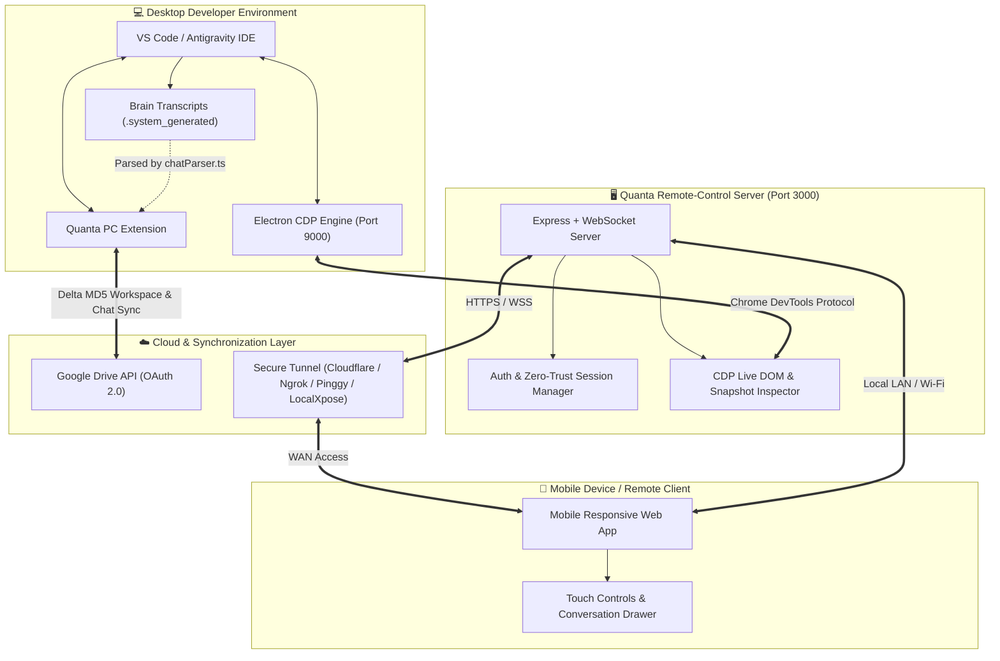

<div align="center">


<a href="https://github.com/dark-yoddha/Quanta-IDE">
  
</a>

<br/>

[](https://github.com/dark-yoddha/Quanta-IDE)
[](https://nodejs.org/)
[](https://www.typescriptlang.org/)
[](https://code.visualstudio.com/)
[](https://developers.google.com/drive)
[](Remote-Control/LICENSE)

<br/>

**[Overview](#-what-is-quanta-ide)** &nbsp;•&nbsp;
**[Architecture](#-system-architecture)** &nbsp;•&nbsp;
**[Features](#-features)** &nbsp;•&nbsp;
**[Quick Start](#-quick-start)** &nbsp;•&nbsp;
**[Commands](#-extension-commands)** &nbsp;•&nbsp;
**[Security](#-security--privacy)** &nbsp;•&nbsp;
**[Team](#-core-team)**

<br/>

**Built with passion by**
[**Akira-official**](https://github.com/Akira-official) &nbsp;&amp;&nbsp; [**dark-yoddha**](https://github.com/dark-yoddha)

</div>

---

## 🌌 What is Quanta IDE?

> **Start an AI task at your desk. Walk away. Keep watching it think. Pick up on any machine.**

**Quanta IDE** bridges the power of your desktop IDE with the freedom of mobility and the cloud. It is built specifically for developers using **VS Code** and **Google Antigravity IDE**, and it ships as two tightly integrated systems:

<table>
  <tr>
    <td width="50%" valign="top">
      <h3>🔌 Quanta PC Extension</h3>
      <p>A native <b>VS Code extension</b> that keeps your workspace mirrored on <b>Google Drive</b> using intelligent, delta-hashed, bidirectional sync, and exports your <b>Antigravity AI chat transcripts</b> as clean structured JSON.</p>
      <sub><code>Quanta-PC-Extension/</code> &middot; TypeScript</sub>
    </td>
    <td width="50%" valign="top">
      <h3>📱 Quanta Remote-Control</h3>
      <p>A real-time <b>Node.js + WebSocket</b> server that hooks into Antigravity through the <b>Chrome DevTools Protocol (CDP)</b> and streams live snapshots and AI thinking states to any mobile browser, over LAN or an encrypted global tunnel.</p>
      <sub><code>Remote-Control/</code> &middot; Node.js</sub>
    </td>
  </tr>
</table>

---

## 🏛️ System Architecture



### 🔄 How a typical session flows

| Step | What happens | Handled by |
| :---: | :--- | :--- |
| **1** | Launch Antigravity with remote debugging on port `9000` | Antigravity IDE |
| **2** | Start the server, scan the QR code with your phone | `Remote-Control` |
| **3** | Trigger an AI task on your desktop and step away | You |
| **4** | Watch live snapshots and agent reasoning on your phone | CDP → WebSocket → Mobile |
| **5** | Send follow-up prompts or approvals remotely | Mobile → Server → IDE |
| **6** | Push your workspace and chat history to Google Drive | `Quanta-PC-Extension` |

---

## ✨ Features

### 🔌 Quanta PC Extension

*A native TypeScript extension for VS Code and Google Antigravity.*

<details open>
<summary><b>⚡ Google Drive Delta Sync</b> &nbsp;<code>quanta.push</code> · <code>quanta.pull</code></summary>
<br/>

| Capability | Details |
| :--- | :--- |
| 🔐 **MD5 Content Deduplication** | Local and remote MD5 checksums are compared, so only modified files are uploaded or downloaded. |
| 🌳 **Tree-Aware Folder Creation** | Project folders are traversed recursively and sorted by depth, preventing duplicate-folder race conditions on Drive. |
| 🚀 **Chunked Concurrency** | Uploads and downloads run in concurrent batches of 10 files for strong network throughput. |
| 🧹 **Remote Orphan Cleanup** | Files deleted locally are removed from the remote directory, keeping a pristine mirror. |

</details>

<details open>
<summary><b>🧠 Antigravity Chat Transcript Extraction</b> &nbsp;<code>quanta.syncChats</code></summary>
<br/>

- Scans `~/.gemini/antigravity-ide/brain/` for active workspace conversations.
- Extracts the raw `.system_generated/logs/transcript.jsonl` files.
- Parses agent thought steps, user inputs, tool invocations, and responses into a clean structured document, **`antigravity_chats.json`**, synced to Google Drive.

</details>

<details open>
<summary><b>🎨 Dedicated Activity Bar Sidebar</b></summary>
<br/>

- Custom webview showing live **OAuth connection status**.
- One-click buttons to **push**, **pull**, **sync conversations**, or **re-authenticate**.

</details>

---

### 📱 Quanta Remote-Control

*A sub-100ms real-time monitoring and control server for your phone.*

<details open>
<summary><b>🚀 Sub-100ms Real-Time Mirroring</b></summary>
<br/>

- Attaches to Antigravity's remote debugging port (`--remote-debugging-port=9000`).
- Captures live DOM trees, visual snapshots, and agent progress directly through CDP, with no heavy screen-recording overhead.

</details>

<details open>
<summary><b>📱 Mobile-First Native Experience</b></summary>
<br/>

- Touch-optimized **gesture drawer** to switch conversations on the fly.
- Responsive **markdown viewer** rendering AI code blocks, diffs, and formatting.
- **Remote prompt dispatch**: send follow-ups or approvals straight from your smartphone.

</details>

<details open>
<summary><b>🛡️ Zero-Trust Security Architecture</b></summary>
<br/>

- Strict Content Security Policy (`default-src 'self'`).
- Signed, `httpOnly`, `SameSite=Strict` cookie authentication.
- **LAN auto-trust** with a QR code in the terminal for one-tap home pairing.
- **`APP_PASSWORD`** enforced for every external connection.

</details>

<details open>
<summary><b>🌍 Global Tunnelling Out of the Box</b></summary>
<br/>

<div align="center">


</div>

Reach your active workstation from mobile cellular data, anywhere in the world.

</details>

---

## 📁 Repository Structure

```text
quanta-ide/
├── .env.example                 # Root configuration template for credentials & ports
├── client_secret.example.json   # Google Cloud OAuth client credentials template
├── .gitignore                   # Multi-tier ignore rules (secrets, dist, node_modules)
├── README.md                    # Project documentation (this file)
│
├── Quanta-PC-Extension/         # VS Code & Antigravity Extension
│   ├── src/
│   │   ├── extension.ts         # Entrypoint, command registrations, lifecycle
│   │   ├── auth.ts              # OAuth 2.0 loopback server & token storage
│   │   ├── gdrive.ts            # Google Drive API v3 operations (CRUD, tree, upload)
│   │   ├── chatParser.ts        # Antigravity brain transcript parser & sanitizer
│   │   └── sidebar.ts           # Activity bar Webview provider & UI templates
│   ├── package.json             # Extension manifest & scripts
│   ├── tsconfig.json            # TypeScript configuration
│   └── webpack.config.js        # Production bundle configuration
│
└── Remote-Control/              # Real-Time Mobile Server & Client
    ├── server.js                # Core Express + WebSocket + CDP bridge server
    ├── ui_inspector.js          # CDP DOM parsing and visual element extractor
    ├── generate_ssl.js          # Self-signed certificate generator for LAN HTTPS
    ├── launcher.py              # Cross-platform runner with dependency verification
    ├── package.json             # Server dependencies (Express, WS, dotenv)
    ├── public/                  # Mobile Web Client application
    │   ├── index.html           # Main mobile chat interface & snapshot viewer
    │   ├── login.html           # Authentication portal
    │   ├── css/                 # Responsive styling & animations
    │   └── js/                  # WebSocket listener, touch handling, drawer logic
    └── assets/                  # Logos, icons, and hero graphics
```

---

## 🛠️ Prerequisites

| Requirement | Version |
| :--- | :--- |
|  | `v18.0.0`+ (`v24.x` recommended) |
|  | `v9.0.0`+ |
|  | Antigravity IDE or VS Code `^1.80.0` |
|  | A project with **Drive API enabled** and **OAuth 2.0 Client Credentials** configured |

---

## 🚀 Quick Start

### Step 1 &nbsp;·&nbsp; Clone the repository

```bash
git clone https://github.com/dark-yoddha/Quanta-IDE.git
cd Quanta-IDE
```

### Step 2 &nbsp;·&nbsp; Configure your environment

```bash
cp .env.example .env
```

<details>
<summary><b>📄 Click to view the full <code>.env</code> reference</b></summary>

```env
# ===================================================================
# Quanta IDE - Global Environment Configuration
# ===================================================================

# Google Cloud OAuth 2.0 Credentials (for Extension Drive Sync)
GOOGLE_CLIENT_ID=your-google-client-id.apps.googleusercontent.com
GOOGLE_CLIENT_SECRET=your-google-client-secret
GOOGLE_PROJECT_ID=your-google-project-id

# Quanta PC Extension
QUANTA_CLIENT_ID=your-google-client-id.apps.googleusercontent.com
QUANTA_CLIENT_SECRET=your-google-client-secret

# Remote-Control Server Settings
APP_PASSWORD=choose-a-strong-password
PORT=3000
TUNNEL_PROVIDER=cloudflare        # Options: cloudflare, ngrok, pinggy, localxpose, none
NGROK_AUTHTOKEN=your-ngrok-token   # Required if TUNNEL_PROVIDER=ngrok
```

</details>

> [!WARNING]
> Never commit your real `.env` or `client_secret.json`. They are covered by `.gitignore`, but double-check before every push.

### Step 3 &nbsp;·&nbsp; Set up the PC Extension 🔌

```bash
cd Quanta-PC-Extension
npm install
npm run compile
```

Then either:

- Open `Quanta-PC-Extension` in VS Code and press <kbd>F5</kbd> to launch an **Extension Development Host**, or
- Package it into a `.vsix`:

  ```bash
  npx @vscode/vsce package
  ```

### Step 4 &nbsp;·&nbsp; Set up the Remote-Control server 📱

**1. Launch Antigravity in debug mode** so the server can bridge into its session:

```bash
antigravity . --remote-debugging-port=9000
```

**2. Install dependencies**

```bash
cd Remote-Control
npm install
```

**3. Start the server**

```bash
npm start
# or on Windows:
start_ag_phone_connect.bat
```

**4. Connect your phone**

> [!TIP]
> The terminal prints a local URL (e.g. `https://192.168.1.15:3000`) and a **scannable QR code**. Keep your phone on the same Wi-Fi, scan the code or open the link, and enter your `APP_PASSWORD`.

---

## ⌨️ Extension Commands

Open the Command Palette (<kbd>Ctrl</kbd>+<kbd>Shift</kbd>+<kbd>P</kbd>) and type `Quanta`.

| Command ID | Title | What it does |
| :--- | :--- | :--- |
| `quanta.login` | 🔑 **Quanta: Connect Google Drive** | Starts the local OAuth 2.0 browser login flow for Drive access. |
| `quanta.push` | ⬆️ **Quanta: Push to Google Drive** | Scans the workspace, computes MD5 diffs, and pushes changed files. |
| `quanta.pull` | ⬇️ **Quanta: Pull from Google Drive** | Downloads project files from Drive and syncs your local workspace. |
| `quanta.syncChats` | 🧠 **Quanta: Sync Antigravity Chats** | Ingests `.system_generated` transcript logs and exports formatted chat history. |

---

## 🔒 Security & Privacy

<table>
  <tr>
    <td width="50%" valign="top">
      <b>🚫 Zero Inline Script Execution</b><br/>
      The mobile frontend enforces a strict CSP (<code>script-src 'self'</code>), mitigating client-side XSS injection.
    </td>
    <td width="50%" valign="top">
      <b>🍪 Signed HTTP-Only Auth</b><br/>
      Session cookies are cryptographically signed with your server secret, blocking script inspection and token theft.
    </td>
  </tr>
  <tr>
    <td width="50%" valign="top">
      <b>🔁 Local Loopback OAuth</b><br/>
      Google Drive authorization runs on a local loopback listener (<code>http://localhost:3000/callback</code>), so refresh tokens never pass through external proxies.
    </td>
    <td width="50%" valign="top">
      <b>🗝️ Isolated Credentials</b><br/>
      Tokens, SSL certificates, and chat transcripts are pre-configured in <code>.gitignore</code> to prevent accidental commits.
    </td>
  </tr>
</table>

---

## 👥 Core Team

<div align="center">

<table>
  <tr>
    <td align="center" width="220">
      <a href="https://github.com/Akira-official">
        <br/>
        <sub><b>Akira-official</b></sub>
      </a><br/>
      <sub>Co-Creator &amp; Lead Developer</sub>
    </td>
    <td align="center" width="220">
      <a href="https://github.com/dark-yoddha">
        <br/>
        <sub><b>dark-yoddha</b></sub>
      </a><br/>
      <sub>Co-Creator &amp; Lead Developer</sub>
    </td>
  </tr>
</table>

</div>

---

## 📄 License

Licensed under the **GNU General Public License v3.0** (GPLv3). See the [LICENSE](Remote-Control/LICENSE) file for details.

<div align="center">

<br/>

**If Quanta IDE helps your workflow, drop a ⭐ on the repo!**


</div>
